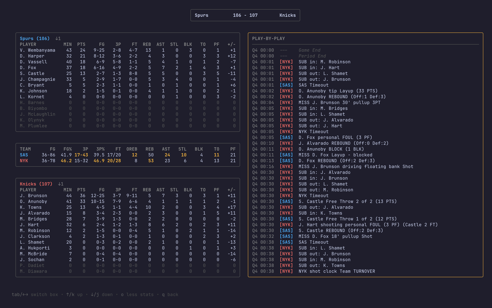

# Courtside

A terminal UI for NBA games, box scores, standings, teams, and players.

Browse the day's games, drill into a live or finished game for its full box
score and play-by-play, jump to any date to see past results, and check the
league standings. Explore all 30 teams, their rosters and coaching staff,
injury updates, reported salaries, and individual player profiles with career
stats and game logs. Games in progress refresh on their own while you watch.

## Data

Courtside pulls directly from the NBA's public JSON endpoints, using
[`nba-sdk`](https://github.com/NolanFogarty/nba-sdk) for game feeds and direct
requests for team and player profiles:

- **cdn.nba.com** — live box scores and play-by-play (preferred for game details)
- **stats.nba.com** — today's scoreboard and scoreboard by date, fallback traditional
  box scores and play-by-play, standings, rosters, team profiles, player bios, career statistics,
  and game logs

If both NBA box-score feeds fail or return no player data, game details fall
back to ESPN's public scoreboard and game summary. 

Team injury updates and reported salaries come from ESPN's public JSON feeds
(`site.api.espn.com`), labeled separately in the app. Salary figures are matched
to the current season; missing values stay unavailable. Reported totals cover
only matched roster salaries, excluding dead money, cap holds, and tax. The
injuries section also links to the NBA's official game-status reports. Team and
player pages support manual refresh with `r`, with failures shown per section.

These are unofficial, undocumented endpoints, so there's **no API key or
account required** but they can change or rate-limit without notice. Live
games auto-refresh roughly every 15 seconds. 

## Installation

### Install from source

```bash
git clone https://github.com/NolanFogarty/courtside.git
cd courtside
go build -o courtside
sudo mv courtside /usr/local/bin/
```

### Install with go install

```bash
go install github.com/NolanFogarty/courtside@latest
```

## Usage

```bash
courtside
```

The app opens on today's games. Everything is keyboard-driven:

### Game list

| Key | Action |
| --- | --- |
| `↑`/`k`, `↓`/`j` | Move between games |
| `tab` | Switch between the Eastern and Western columns |
| `pgup`/`pgdn` | Turn the page on extra-busy days |
| `enter` | Open the selected game's details |
| `←`/`h`, `→`/`l` | Previous / next day |
| `d` | Jump to a specific date |
| `s` | League standings |
| `a` | Full-season schedule |
| `t` | Team browser (also available from other pages) |
| `/` | Filter games |
| `q` | Quit |

### Game details

| Key | Action |
| --- | --- |
| `↑`/`k`, `↓`/`j` | Scroll the play-by-play feed |
| `o` | Toggle expanded stats |
| `q`/`esc` | Back to the game list |

### Standings

| Key | Action |
| --- | --- |
| `q`/`esc` | Back to the game list |

### Teams and players

Press `t`, search by team name or abbreviation with `/`, and press `enter`.
Team sections include a roster with season averages and physical details,
season record and league ranks, arena and management details, championships,
retired numbers and Hall of Fame entries, coaching staff and acquisitions, injury notes
with update dates and estimated returns, salary coverage and totals, and
completed games. `enter` on a roster or salary row opens that player's bio,
draft details, career averages, season history, playoff stats, and game log.

| Key | Action |
| --- | --- |
| `←`/`→`, `tab`/`shift+tab` | Switch section |
| `1`–`5` | Jump to a team section (`1`–`4` for players) |
| `↑`/`k`, `↓`/`j` | Select a player or scroll |
| `pgup`/`pgdown`, `home`/`end` | Page or jump through the section |
| `enter` | Open the selected player's details |
| `o` | Switch counting/shooting stats on player pages |
| `r` | Refresh the current team or player |
| `a` | Open the selected team's season schedule |
| `t` | Return to the team browser |
| `q`/`esc` | Back, preserving the team and player selection |

Roster, salary, team game results, and player career, playoff, and game-log
columns are sortable. Press `s` to focus the headers, use `←`/`→` to choose a
column, then `↑` for ascending, `↓` for descending, or `enter` to toggle the
order. `esc` exits sorting and stays on the page. The active header shows an
arrow; missing values stay at the bottom in either direction. Each section
keeps its sort choice, and sorting a roster keeps the same player selected.

Data uses bordered tables with bright-white focus and sort highlights. Wide
tables keep the identifying column visible; `[`/`]` scroll through the other
columns. Player statistics retain their headers while paging vertically.

The bottom shortcuts wrap into centered rows when they do not fit on one line.

## Screenshots

### Game List


### Game Details


### Standings

